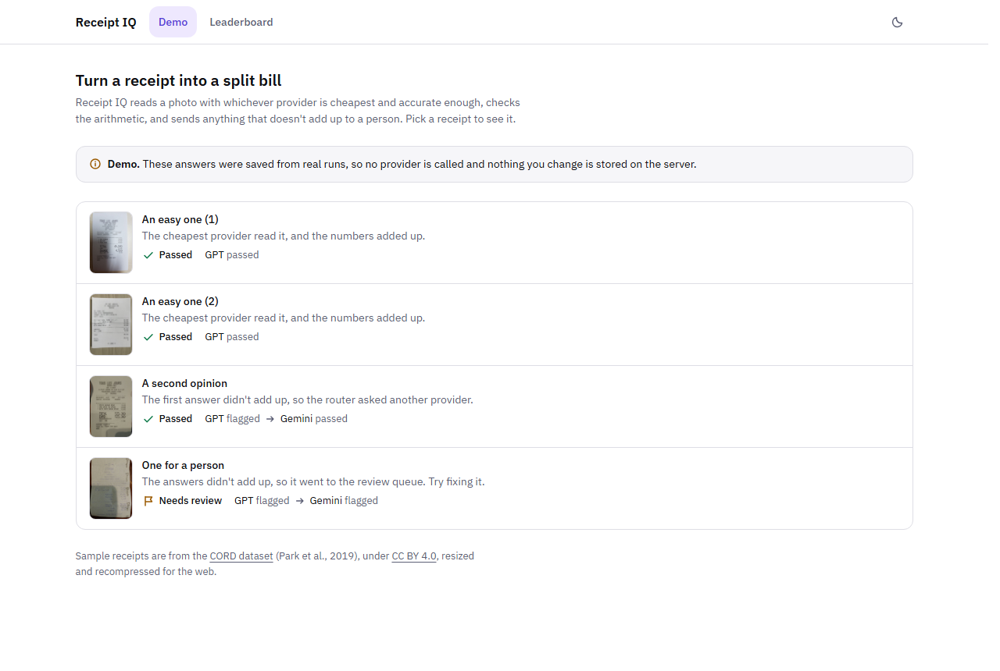
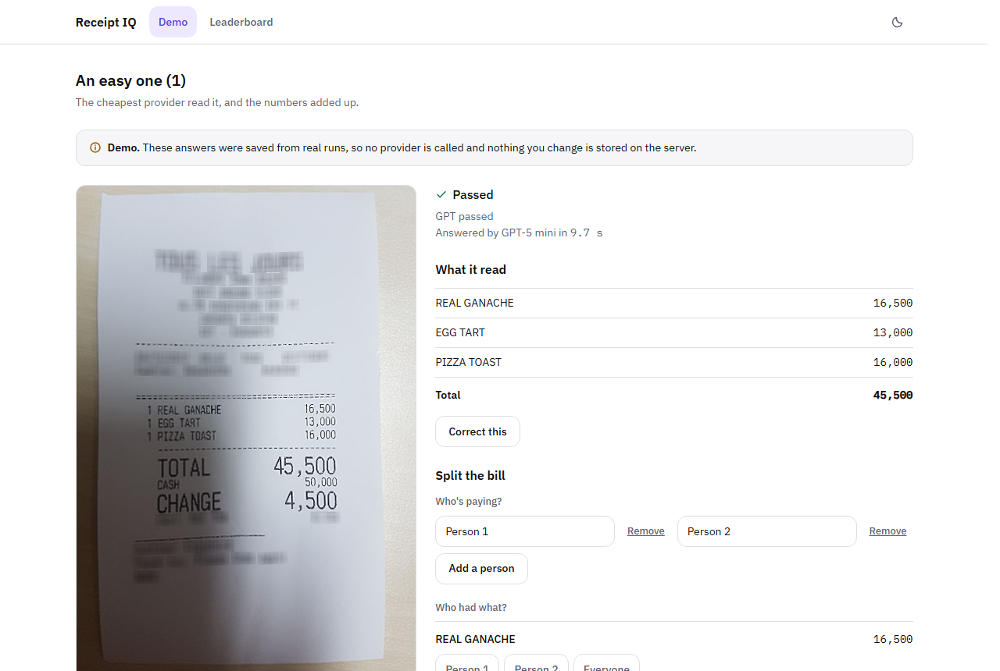
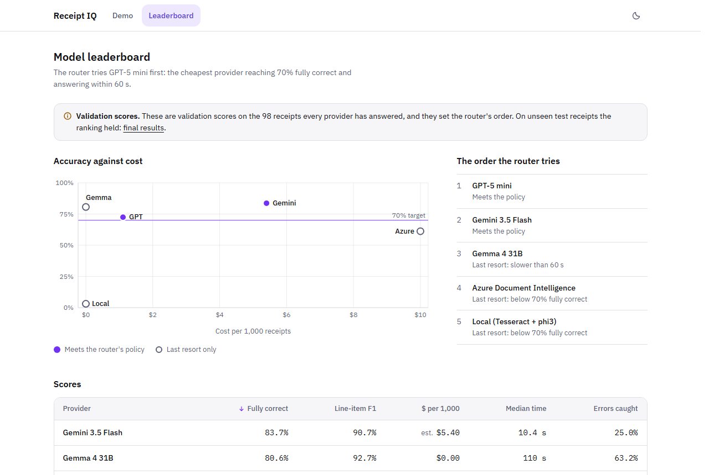
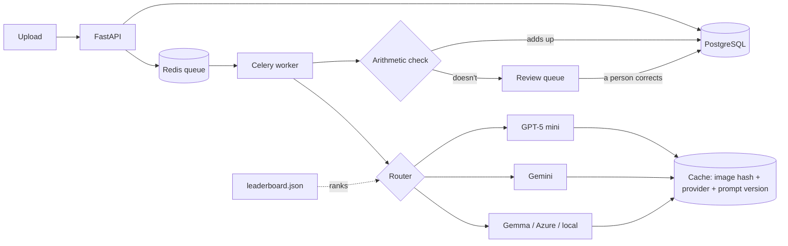

# Receipt IQ

[](https://github.com/tanmayee043/receipt-iq/actions/workflows/ci.yml)
[](LICENSE)

Turn receipt photos into checked, itemized data, and know which AI provider to trust with them.

**Live demo:** [receipt-iq-m7bq.onrender.com](https://receipt-iq-m7bq.onrender.com)

## Why this exists

Expense tools, accounts-payable teams and bill-splitting apps all turn paper receipts into data.
Calling an AI model to read a receipt is the easy part. The hard part is everything around it:

- **Which provider should read it?** Accuracy, price and speed differ widely, and the most accurate
  one is rarely the cheapest.
- **Is the answer right?** Models misread numbers in ways that look plausible, and a wrong amount
  that reaches the books is expensive to find later.
- **What happens when it's wrong?** Someone has to fix it, and the fix should improve the data, not
  disappear.

Receipt IQ answers those three questions with measurements instead of guesses. It scores five
providers on the same labeled receipts, routes each new receipt to the cheapest one that is
accurate enough, checks every answer's arithmetic, and sends anything that doesn't add up to a
person.

## What happens to a receipt

1. **Upload.** The photo is checked (a real JPEG or PNG, at most 10 MB) and saved under its hash,
   so the same photo is never processed twice.
2. **Queue.** It waits in a background queue, so the upload returns straight away.
3. **Route.** The router picks the cheapest provider that scored at least 70% fully correct and
   answers within 60 seconds. A provider that keeps failing is skipped for a while.
4. **Read.** The provider returns the items, subtotal, discount, service charge, tax and total.
5. **Check.** The arithmetic must add up: each line, the items against the subtotal, and
   `subtotal - discount + service + tax + tip = total`. If it doesn't, a second provider is asked.
6. **Save or review.** An answer that adds up is saved. One that still doesn't goes to the review
   queue with the problem marked, where a person corrects or dismisses it.

## Results

Measured on the public [CORD](https://github.com/clovaai/cord) receipt dataset, which comes with
hand-made answers. Everything was tuned on one set of receipts (validation), then scored once on a
separate set the tuning never saw (test, 95 receipts). The numbers below are from the test set.

- **Fully correct:** every amount and every item on the receipt is right.
- **Line-item F1:** how well the items were read, combining items found and items missed (100% is
  perfect).

| Provider | Fully correct | Line-item F1 | Median time |
|---|---|---|---|
| Gemini 3.5 Flash | **85.3%** | **96.1%** | 9.3 s |
| Gemma 4 31B | 80.0% | 88.5% | 70.6 s |
| GPT-5 mini (Azure OpenAI) | 74.7% | 94.2% | 9.9 s |
| Azure Document Intelligence | 57.9% | 90.9% | 9.0 s |
| Local: Tesseract OCR + phi3 | 4.2% | 26.8% | 21.8 s |

- **Routing cut cost by 67%:** $1.79 per 1,000 receipts against $5.40 for always using the most
  accurate provider, at 82.1% fully correct (3 of 95 receipts fewer) and with the same 3.2% of
  receipts sent to a person.
- **The ranking held on unseen receipts:** each provider scored within a few points of its tuning
  score, so the results weren't fitted to the test set.
- **Reading the image beats OCR plus a small model:** no prompt recovers text that OCR never read.

| Demo | A receipt and its bill split | Leaderboard |
|---|---|---|
|  |  |  |

Full results, per field and per provider: [docs/evaluation.md](docs/evaluation.md).

## How it works



| Part | What it does |
|---|---|
| **Providers** | Five interchangeable readers that all return the same receipt format; money is kept exact, never as a floating-point number |
| **Validator** | The arithmetic check, which also records where each problem is (for example `items[2]`) |
| **Router** | Chooses a provider from the measured scores in `leaderboard.json`, asks a second one when an answer doesn't add up, and skips failing providers |
| **Task queue** | One background task per receipt, with retries for temporary failures and a separate list for receipts no provider can read |
| **Cache** | Stores every answer by image, provider and prompt version, so nothing is paid for twice |
| **Review queue** | Receipts waiting for a person; corrections go through the same check and are kept beside the model's answer |
| **API and screens** | Owner login, rate limits and upload checks; React screens for upload, review, routing log and leaderboard |
| **Public demo** | The demo and leaderboard only, with no database, queue or keys, so visitors can't spend anything |

**Stack:** Python 3.11 · FastAPI · Celery · Redis · PostgreSQL · SQLAlchemy · Alembic · React ·
TypeScript · Tailwind CSS · Docker · GitHub Actions

More detail: [architecture](docs/architecture.md) · [screens](docs/screens.md) ·
[design system](DESIGN.md)

## Quick start: run the demo

Needs only [Docker](https://docs.docker.com/get-docker/).

```bash
git clone https://github.com/tanmayee043/receipt-iq.git
cd receipt-iq
docker build -t receipt-iq-demo .
docker run --rm -p 8000:8000 receipt-iq-demo
```

Open http://localhost:8000. (The log's `http://0.0.0.0:8000` is where the server listens inside
the container, not an address to open.) Pick a sample receipt, correct an amount to see the check reject it,
split the bill between people, and open the leaderboard. The demo uses saved answers, so it needs no
keys and calls no provider.

## Run the full app

The full app adds uploading, the background worker, the review queue and the routing log.

### Prerequisites

| Tool | Version | Used for |
|---|---|---|
| [Python](https://www.python.org/downloads/) | 3.11 | The API, worker and scripts |
| [Node.js](https://nodejs.org/) | 24 | Building the screens |
| [Docker](https://docs.docker.com/get-docker/) | Any recent | PostgreSQL and Redis |
| At least one provider account | | Reading receipts; see [Configure](#3-configure) |
| [Tesseract](https://github.com/tesseract-ocr/tesseract) and [Ollama](https://ollama.com/) | Optional | The local provider, which keeps receipts on your machine |

### 1. Install

```bash
git clone https://github.com/tanmayee043/receipt-iq.git
cd receipt-iq
python -m venv .venv
```

Activate the environment, then install:

```bash
source .venv/bin/activate        # macOS and Linux
.venv\Scripts\Activate.ps1       # Windows PowerShell
```

```bash
pip install -e ".[dev]"
npm --prefix frontend ci
npm --prefix frontend run build
```

### 2. Start PostgreSQL and Redis

```bash
docker compose up -d --wait
cp .env.example .env             # Windows: copy .env.example .env
alembic upgrade head
```

Both services listen on this machine only. `.env` holds their local addresses and no secrets.
`alembic upgrade head` creates the database tables.

### 3. Configure

Secrets are environment variables, never files in the repo. Create the owner password first:

```bash
python scripts/hash_password.py
```

It asks for a password (at least 12 characters) and prints a hash. Set that hash, plain-http
cookies for local use, and at least one provider's keys (see the table) in each terminal you start
the app from:

```bash
# macOS and Linux
export OWNER_PASSWORD_HASH='<the printed hash>'
export COOKIE_SECURE=false
export GEMINI_API_KEY='<your key>'
```

```powershell
# Windows PowerShell
$env:OWNER_PASSWORD_HASH = '<the printed hash>'
$env:COOKIE_SECURE = 'false'
$env:GEMINI_API_KEY = '<your key>'
```

| Variable | Required | What it is |
|---|---|---|
| `DATABASE_URL`, `REDIS_URL` | Yes | Set in `.env` by step 2 |
| `OWNER_PASSWORD_HASH` | Yes | The hash from `hash_password.py`; the server won't start without it |
| `COOKIE_SECURE` | For local use | Set to `false` when using plain `http://localhost`, or the login cookie won't be sent |
| `GEMINI_API_KEY` | One provider | Gemini and Gemma, from [Google AI Studio](https://aistudio.google.com/apikey) |
| `AZURE_OPENAI_ENDPOINT`, `AZURE_OPENAI_KEY`, `AZURE_OPENAI_DEPLOYMENT` | One provider | A GPT-5 mini deployment in [Azure AI Foundry](https://ai.azure.com/) |
| `AZURE_DI_ENDPOINT`, `AZURE_DI_KEY` | One provider | An [Azure Document Intelligence](https://learn.microsoft.com/azure/ai-services/document-intelligence/) resource |
| `OLLAMA_URL`, `TESSERACT_CMD` | No | The local provider: run `ollama pull phi3` first; defaults are `http://localhost:11434` and `tesseract` on the path |
| `RATE_LIMIT_GENERAL`, `RATE_LIMIT_UPLOAD`, `RATE_LIMIT_LOGIN` | No | Requests per minute per visitor; defaults 120, 10 and 5 |

The router skips any provider without keys, so one is enough to start.

### 4. Start the worker and the server

Use two terminals, both in the project folder, with the environment active and the variables from
step 3 set:

```bash
celery -A receipt_iq.tasks worker --pool=solo --loglevel=info      # terminal 1
uvicorn receipt_iq.api:create_app --factory                        # terminal 2
```

### 5. Check it works

1. Open http://127.0.0.1:8000 and log in with your password.
2. On **Upload**, choose a receipt photo, for example one from `demo/images/`.
3. The receipt page shows "Reading this receipt", then updates by itself with what was read.
4. If the arithmetic didn't add up, it appears in **Review** with the problem marked.
5. **Routing log** shows which providers were tried and why.
6. http://127.0.0.1:8000/api/docs lists every API endpoint.

### 6. Stop

Press `Ctrl+C` in both terminals, then stop PostgreSQL and Redis:

```bash
docker compose stop              # keeps your data; start again with docker compose up -d --wait
```

`docker compose down -v` also deletes the stored receipts and corrections.

## Reproduce the evaluation

Needs the keys of the providers you want to score. Answers are cached in `data/`, so an
interrupted run resumes where it stopped.

```bash
python scripts/download_cord.py validation
python scripts/download_cord.py test
python scripts/evaluate.py gemini data/cord/test.parquet       # also: local, azure, gpt
python scripts/build_leaderboard.py                            # router scores, from validation
python scripts/simulate_routing.py data/cord/test.parquet      # routing cost and accuracy
```

## Testing

```bash
ruff check .
mypy src tests scripts
pytest                                  # needs PostgreSQL and Redis from step 2
npm --prefix frontend test
npm --prefix frontend run test:e2e      # after building the screens
```

Tests use a real PostgreSQL and Redis and never call a provider. CI runs all of them on every
push and pull request.

## Project structure

```
src/receipt_iq/
  schema.py, validation.py     The receipt format and the arithmetic check
  providers/                   Local, Gemini and Gemma, Azure Document Intelligence, Azure OpenAI
  evaluation.py, cache.py      Scoring against the answers; the answer cache
  router.py                    Provider choice, second opinions, skipping failing providers
  tasks.py                     Background tasks, retries and unreadable receipts
  db.py, review.py             Database tables and the review queue
  web.py, api.py               The public pages and demo; the full API
frontend/                      React screens and their tests
scripts/                       Evaluation, routing simulation, leaderboard, demo and review tools
migrations/                    Database migrations
demo/                          Sample receipts and saved answers for the demo
docs/                          Evaluation, architecture and screen details
```

## Design decisions

- **Measure before routing.** Every provider is scored on the same labeled receipts, and the router
  reads those scores, so each choice can be traced to a number.
- **Tune on one set, report on another.** The test receipts were scored once, after the prompt and
  router were fixed.
- **Arithmetic as the check.** It needs no second model and caught real provider bugs, such as
  "8.000" read as 8.
- **Never pay twice.** Answers are cached by image, provider and prompt version.
- **A person has the last word.** A later run never overwrites a correction.

## Limitations

- The check can't see mistakes that still add up, such as a wrong item name. Most of Gemini's
  errors were of that kind, so only 14% of them were flagged.
- CORD receipts are Indonesian, in rupiah, with no dates or store names, so accuracy may differ on
  other receipts.
- Costs are list prices; Gemini's estimate assumes the same token counts as GPT-5 mini.
- Photos only: no PDFs or multi-page documents.
- One owner account, so corrections aren't attributed to a person.

## Data

Sample receipts are from [CORD](https://github.com/clovaai/cord) (Park et al., 2019) under
[CC BY 4.0](https://creativecommons.org/licenses/by/4.0/); see [demo/README.md](demo/README.md).

## License

[MIT](LICENSE)
